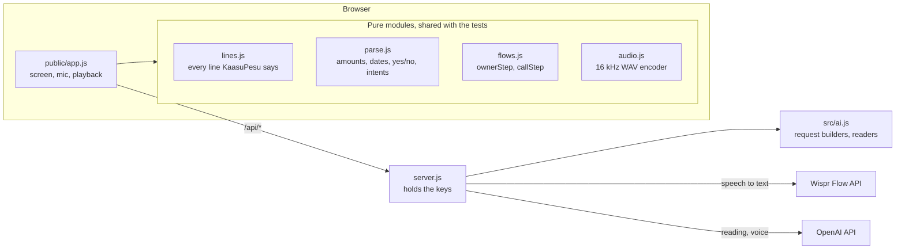
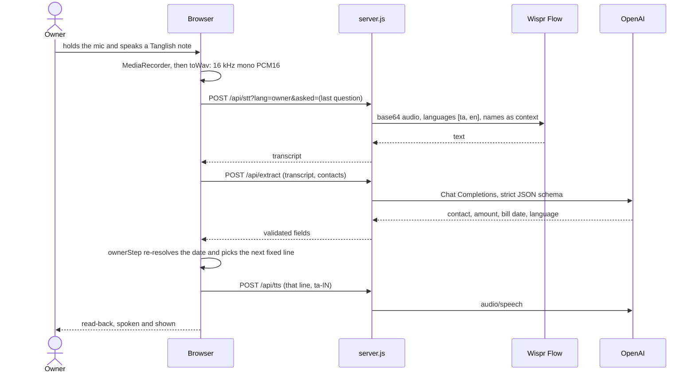
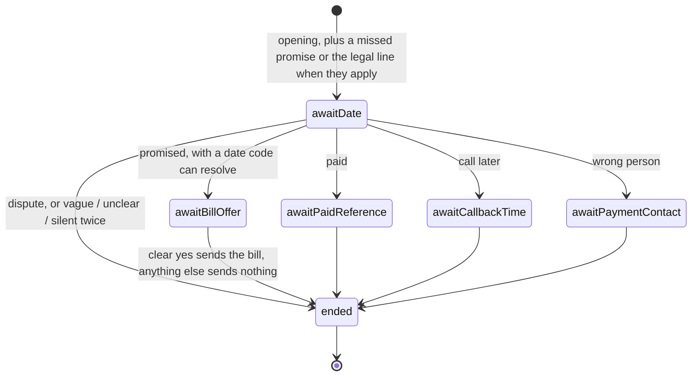

# KaasuPesu: architecture

**Job of this file:** explain how KaasuPesu is put together and why it is shaped this way. What it must do is in
[PRD.md](PRD.md); the decisions behind each choice are logged in [CLAUDE.md](../CLAUDE.md).

## Principles

1. **A pure core, a thin shell.** Every decision lives in pure functions (`src/`), tested in Node without a
   browser or a network. The screen and the server only move data in and out.
2. **A model never writes what KaasuPesu says.** Every line is a fixed string per language in `src/lines.js`.
   Models only read and label what people say.
3. **Code has the last word.** A model's label is checked against the seven intents and its dates are resolved
   again by code, so a model can't record a promise the buyer didn't make.
4. **Every AI part is optional.** With no keys, the app runs on browser speech and built-in rules. When a
   provider fails, the rules read the text, the browser's voice speaks, or the owner is asked to type.
5. **Nothing to install.** No framework, build step, database or npm dependencies; Node built-ins and vanilla JS.

## Components

| File | Responsibility | Tested by |
|---|---|---|
| `src/lines.js` | Seed contacts and bills, and every sentence KaasuPesu says, per language | `test/logic.test.js` |
| `src/parse.js` | Reads Roman-script text: amounts, dates, contacts, yes/no (also Tamil script and Devanagari), intents | `test/logic.test.js` |
| `src/flows.js` | The two conversations: `ownerStep` and `callStep` take a state and one input and return a new state and the lines to say | `test/logic.test.js` |
| `src/ai.js` | Builds OpenAI and Wispr requests, reads and validates their answers | `test/ai.test.js` |
| `src/audio.js` | Encodes 16 kHz mono PCM16 WAV for Wispr | `test/audio.test.js` |
| `server.js` | Serves six allowlisted files, holds the keys, forwards the four AI routes | curl checks in the verification log |
| `public/app.js` | Renders the three screens, records the mic, plays speech, keeps app state | headless browser runs in the verification log |

## The two paths

| | Without keys (default) | With `OPENAI_API_KEY` and `WISPR_API_KEY` |
|---|---|---|
| Hearing | Chrome's speech recognition, en-IN | Wispr Flow: 16 kHz WAV; listens for Tamil and English from the owner, or the buyer's language and English; contact names and the last question go as context |
| Reading | Rules in `parse.js` | OpenAI `gpt-6-luna`, Chat Completions, reasoning effort `none`, strict JSON schema; the rules re-check the answer |
| Speaking | The browser's voices | OpenAI `gpt-4o-mini-tts` |

`GET /api/config` tells the browser which parts are on. Wispr is offered only when GPT reading is on, because Wispr
may write Tamil or Devanagari, which the rules can't read.

## One voice note, end to end (keyed path)

The buyer's side is the same loop: `/api/stt` with the call language, `/api/classify` for the intent, `callStep`
for the next line.

## The call as a state machine

The owner's side moves through `idle`, `collecting` (asks only for what is missing), `askNumber` and
`confirmNumber` (an unknown contact), `choosingAmount` (a heard sound-alike amount), `confirming` (the read-back),
`correcting` (after "Illa") and `ready` (the call starts).

## Data

| Thing | Fields |
|---|---|
| Contact | `id`, `name`, `business`, `city`, `language` (hi, ta, en), `phone`, `callName`, `ownerRef`, `pronoun`, `aliases` |
| Bill | `id`, `contactId`, `amount`, `billDate`, `promisedDate`, `paid`, `disputed`, `language`, `calls` |
| Call record | `time`, `turns` (each with `who`, the line or text, and `at`, seconds into the call), `summary` (`intent`, `detail`, `tone`, `nextStep`, `keyMoment`, `voiceNote`) |

App state is never changed in place: each step returns a new object, and the screen swaps it in and re-renders.
Only the microphone handles and the speech queue are mutable. Nothing is saved; a reload resets to the seed data,
and today is pinned to 20 November 2026.

## Security

- The server listens on `HOST`, 127.0.0.1 by default. When a key is set, it answers only `Host: 127.0.0.1:PORT`
  or `localhost:PORT`, so a DNS-rebinding page can't spend it. Without keys there is nothing to spend, so any
  address is answered: a judge may open the port by IP. The Docker image listens on 0.0.0.0 and never has a key:
  `docker-compose.yml` passes none, and `.dockerignore` keeps `.env` out of the image.
- Keys live in `.env` on the server. `/api/config` returns three booleans; the browser never sees a key.
- Only six files are served. `.env`, `server.js` and `src/ai.js` answer 404.
- Every input is checked: JSON up to 16 KB, audio up to 5 MB and must be WAV, text up to 2,000 characters,
  `lang` against an allowlist with `Object.hasOwn`, and the context question cut to 300 characters.
- Responses carry a Content-Security-Policy, `nosniff`, `no-referrer` and `no-store`. Provider calls time out
  after 20 seconds.

## When things fail

| Failure | What happens |
|---|---|
| No keys | Browser speech recognition, the rules and the browser's voices; the line at the top says so |
| Reading fails: a provider error, refusal, cut-off or off-schema answer | The rules read the text instead, and a short notice says so |
| Speaking fails | The browser's voice speaks the same line |
| Transcribing fails, or the audio can't be decoded | "Could not transcribe that. Type instead."; it counts as a failed recording |
| A recording under one second, or an empty transcript | "Sariya kekkala, innoru thadava sollunga."; after two, a text box |
| Two unclear replies or two silences on a call | "I'll call back later", logged as unclear |
| A model labels a reply "promised" without a date code can resolve | Treated as vague; no promise is recorded |

## Known limits

- The rules read Roman script only, plus Tamil-script and Devanagari yes/no; free speech in native script needs
  GPT reading on.
- OpenAI has deprecated `gpt-4o-mini-tts` (shutdown on 6 January 2027); moving to the Realtime API is a bigger
  change.
- The Hindi and Tamil lines need a native speaker's review before anyone hears them for real.
